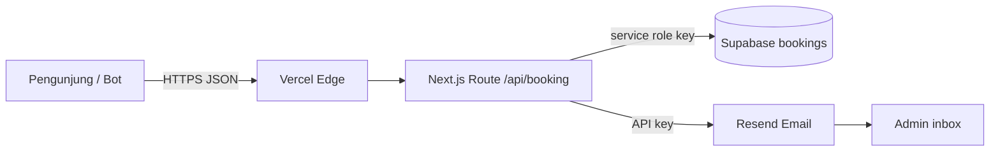

# 4. Threat Model — `POST /api/booking`

Dibuat dengan skill `api-threat-modeling`.

## Arsitektur & Aset

Aset: data pelanggan, `SUPABASE_SERVICE_ROLE_KEY`, `RESEND_API_KEY`, kuota email (100/hari), inbox admin. Tidak ada autentikasi/sesi (form publik), sehingga tidak ada cookie sesi.

## Tabel Ancaman
| ID | Entry point | Ancaman (STRIDE) | Likelihood | Impact | Mitigasi | Status |
|---|---|---|---|---|---|---|
| T1 | POST body | Tampering: HTML injection ke email admin | Sedang | Sedang | Escape HTML di mailer | Terbuka |
| T2 | POST | DoS: flood booking, habisi kuota 100 email/hari | Tinggi | Sedang | Rate limit, CAPTCHA/Turnstile, store bersama | Sebagian |
| T3 | POST | DoS bisnis: habiskan 30 slot global | Sedang | Sedang | CAPTCHA, limit global lebih longgar | Terbuka |
| T4 | Header XFF | Spoofing IP | Sedang | Rendah | IP terakhir di Vercel | Mitigasi (Vercel) |
| T5 | Env/Repo | Info disclosure secret | Rendah | Tinggi | `.env*` ignored, rotasi key, jangan bagikan di chat | Perlu rotasi* |
| T6 | Respons | Info disclosure error | Rendah | Rendah | Pesan generik | Selesai |
| T7 | DB | Broken Access Control | Rendah | Tinggi | RLS deny-all, hanya service role dari server | Selesai |
| T8 | Supabase down | Repudiation: sukses palsu tanpa data tersimpan | Sedang | Sedang | Tampilkan peringatan/log, monitor | Terbuka |
| T9 | Browser | XSS/clickjacking | Rendah | Sedang | CSP, X-Frame-Options | Mitigasi |

*Kunci Supabase dan Resend pernah ditampilkan di percakapan ini; sebaiknya dirotasi bila percakapan dibagikan.

## Security Headers (aktual dari `next.config.ts` vs rekomendasi)
| Header | Aktual | Catatan |
|---|---|---|
| Strict-Transport-Security | `max-age=63072000; includeSubDomains; preload` | Baik |
| X-Content-Type-Options | `nosniff` | Baik |
| Referrer-Policy | `strict-origin-when-cross-origin` | Baik |
| Permissions-Policy | camera/mic/payment kosong, geolocation self | Baik |
| Content-Security-Policy | `script-src 'self' 'unsafe-inline'`, `img-src ... https:` | `unsafe-inline` melemahkan CSP; gunakan nonce bila memungkinkan |
| X-Frame-Options | SAMEORIGIN (menurut audit sebelumnya) | Tambah `frame-ancestors 'self'` di CSP |
| `connect-src` | `'self' https://*.supabase.co` | Browser tidak memanggil Supabase langsung; bisa dipersempit ke `'self'` |

## Checklist Mitigasi Berprioritas
1. Escape HTML `catatan` di email (T1).
2. Tambah Cloudflare Turnstile atau honeypot di form (T2, T3).
3. Pindahkan rate limit ke Upstash Redis (T2, T3).
4. Tambah `frame-ancestors 'self'` dan persempit `connect-src`.
5. Rotasi `RESEND_API_KEY` dan `SUPABASE_SERVICE_ROLE_KEY` (T5).
6. Pantau kegagalan Supabase/Resend lewat log Vercel (T8).

## Asumsi
Domain Resend belum diverifikasi (`onboarding@resend.dev`), sehingga email hanya terkirim ke pemilik akun Resend.

